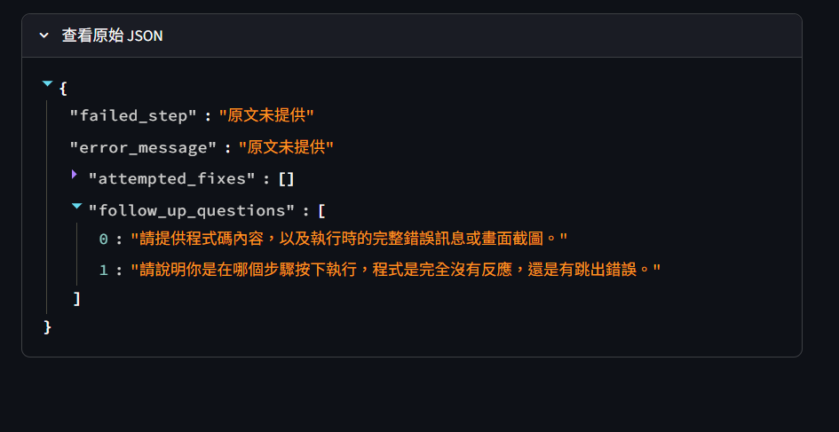

# 第 8 週｜個人專題設計與驗收紀錄

## 一、自己的問題與設計

| 項目 | 我的內容 |
|---|---|
| App 名稱／作者 | 電腦求助訊息整理／李鴻杰 |
| 目標使用者與情境 | 收到同學的電腦或程式求助訊息，需要快速掌握問題並決定先追問什麼。 |
| 想完成的一個任務 | 把一則求助訊息整理成可以逐欄核對的紀錄，並列出下一輪要問的問題。 |
| 輸入資料與範圍 | 貼上一則最多 6,000 字元的純文字求助訊息，內容可包含操作步驟、錯誤訊息和已嘗試的方法。 |
| 資訊不足如何處理 | 已知資訊只取自原文。缺漏的文字欄位顯示「原文未提供」，未提及已嘗試的方法時使用空清單。針對影響後續處理的缺漏提出具體追問。 |
| 採用 starter 或自行實作 | 沿用專題資料夾內的 Pydantic starter，利用既有表單和 API 流程，集中設計求助情境、欄位和結果畫面。 |
| 結構化輸出路線 | Pydantic。用模型定義必填欄位及文字、清單型別，再透過 `responses.parse` 取得可檢查的結構化結果。 |
| 相較教師範例的個人設計 | 預計分開呈現求助者描述的事實與可用的追問。保留原始錯誤文字，方便逐字對照。 |

## 二、輸出欄位契約

| 欄位名稱 | 型別／限制 | 用途 | 畫面標籤 | 如何查原文 |
|---|---|---|---|---|
| `failed_step` | 必填字串。缺漏時填「原文未提供」。 | 確認做了什麼操作，以及問題在何時發生。 | 出問題的操作 | 核對操作與發生時機是否在原文中。 |
| `error_message` | 必填字串。逐字保留原文的錯誤文字，缺漏時填「原文未提供」。 | 取得可比對的錯誤文字。 | 錯誤訊息 | 逐字核對原文中的錯誤內容。 |
| `attempted_fixes` | 必填字串清單。原文未提及時為空清單。 | 知道求助者試過哪些方法。 | 已嘗試的方法 | 每一項都須是求助者明確說已執行的操作。 |
| `follow_up_questions` | 必填字串清單。沒有必要追問時為空清單。 | 知道還要請求助者補充哪些資訊。 | 建議追問 | 確認問題針對原文中的缺漏，並避免重問已提供的資訊。 |

## 三、測試紀錄

| 項目 | 實際輸入／操作 | 實際輸出／錯誤 | 人工判讀與修正 | 證據類型 |
|---|---|---|---|---|
| 空白 | 本機關閉 API、雲端開啟 API，各送出一次空白輸入。 | 「請先輸入要處理的原文。」 | 兩種情境均在呼叫 API 前擋下，這兩次操作合計 0 次請求。 | [本機截圖](photo/空白輸入_離線.png)、[雲端截圖](<photo/正常文字，API 關閉_雲端.png>) |
| 過長 | 本機關閉 API、雲端開啟 API，分別送出超過 6,000 字元的文字。 | 「請縮短到 6000 字元以內；不會默默截斷原文。」 | 兩種情境均在呼叫 API 前擋下，這兩次操作合計 0 次請求。 | [本機截圖](photo/過長輸入_離線.png)、[雲端截圖](photo/過長輸入_雲端.png) |
| 正常文字，API 關閉 | 本機貼上包含操作、錯誤訊息與已嘗試方法的求助文字。 | 顯示輸入與基本設計檢查通過，尚未呼叫 API。 | 0 次 API 請求。 | [本機截圖](<photo/正常文字，API 關閉_離線.png>) |
| 正常資料 | 雲端開啟 API，送出下方的長版虛構訊息。 | 回傳四個欄位並通過格式檢查。 | 操作、錯誤文字與已試方法均可對照原文。第一次未提出追問，重測有詢問 Python 環境與 Streamlit 安裝情況。 | 雲端真實 API，原文與結果見下方。 |
| 資訊不足 | 雲端開啟 API，送出「我的程式跑不起來，可以幫我看一下嗎？」 | 操作和錯誤訊息均為「原文未提供」，已試方法為空清單，並提出兩項追問。 | 結果附的原文與短句一致。追問針對缺少的錯誤訊息與執行步驟。 | [成功提示](photo/資訊不足_雲端真實API_1.png)、[結果畫面](photo/資訊不足_雲端真實API_2.png)、[原始 JSON](photo/資訊不足_雲端真實API_3.png) |
| 結果保存／再送出失敗 | 雲端先取得成功結果，再清空輸入並送出。 | 顯示「請先輸入要處理的原文。」舊成功結果已清除。 | 清除行為通過雲端實測。修改文字但未送出時保留舊結果，另有離線模擬驗證。 | [成功畫面](photo/結果保存_再送出失敗_1.png)、[結果畫面](photo/結果保存_再送出失敗_2.png)、[空白送出後](photo/結果保存_再送出失敗_3.png) | 
| 缺金鑰／服務失敗 | 目前未記錄。 | 未測。 | 待補驗或註記未測。 | 未測 |
| Cloud 部署 | 分支為 `main`，入口為 `Midterm Mini-Project/app.py`。 | 正常資料與資訊不足均取得雲端真實 API 回應。 | 兩筆原文與回應已核對。2026-11-05 已確認訪客無須登入即可開啟 App | [雲端 App](https://1151genai-app-development-ltgwqk3xzwubca3vsepynj.streamlit.app/) |

### 真實 API 測試一｜正常資料

實際模型為 `gpt-5.4-mini`，測試日期 `2026-11-05`。現有截圖可確認首次成功與一次成功重測，完整請求數待確認。

**虛構原文**

~~~text
我在 VS Code 的終端機執行 python app.py，畫面出現以下錯誤：
ModuleNotFoundError: No module named 'streamlit'
我試過關閉並重新開啟終端機，然後再執行一次，還是出現同樣的錯誤。
~~~

**第一次實際輸出**

~~~json
{
  "failed_step": "我在 VS Code 的終端機執行 python app.py，畫面出現以下錯誤：",
  "error_message": "ModuleNotFoundError: No module named 'streamlit'",
  "attempted_fixes": [
    "關閉並重新開啟終端機",
    "再執行一次 python app.py"
  ],
  "follow_up_questions": []
}
~~~

重測的追問包含執行時使用的 Python 環境，以及是否已安裝 Streamlit。這兩項都是原文尚未交代的資訊。

**2026-11-08 雲端重測**。使用同一筆正常資料與 `gpt-5.4-mini`。修改前有一筆結果的「出問題的操作」只寫「原文已提供」。調整指令後，本次結果寫出「在 VS Code 的終端機執行 `python app.py`」，與原文相符，該欄位人工核對通過。本次截圖可確認 1 次真實 API 請求，歷次請求總數未確認。[原文與成功提示](photo/出問題的操作_1.png)、[結果畫面](photo/出問題的操作_2.png)、[原始 JSON](photo/出問題的操作_3.png)

### 真實 API 測試二｜資訊不足

實際模型為 `gpt-5.4-mini`，測試日期 `2026-11-05`。現有截圖可確認一次成功回應，完整請求數待確認。

**虛構原文**

~~~text
我的程式跑不起來，可以幫我看一下嗎？
~~~

**實際輸出**

~~~json
{
  "failed_step": "原文未提供",
  "error_message": "原文未提供",
  "attempted_fixes": [],
  "follow_up_questions": [
    "請提供程式碼內容，以及執行時的完整錯誤訊息或畫面截圖。",
    "請說明你是在哪個步驟按下執行，程式是完全沒有反應，還是有跳出錯誤。"
  ]
}
~~~

## 四、環境、交付與反思

- **環境**。README 指定 Python 3.14。套件清單固定 Streamlit 1.63.0、OpenAI SDK 2.49.0、python-dotenv 1.2.3、Pydantic 2.14.1。初次部署日誌顯示雲端 Python 3.14.10，成功部署版本待核對。[本機套件清單](requirements-local.txt)
- **本機啟動**。在專題目錄建立虛擬環境並安裝 `requirements-local.txt`，使用 `python -m streamlit run app.py` 啟動。[README](README.md)
- **部署**。分支為 `main`，入口為 `Midterm Mini-Project/app.py`。正常資料與資訊不足均已取得雲端真實 API 回應。2026-11-05 已確認訪客無須登入即可開啟 App。[GitHub 專題](https://github.com/nani7749/115_1_GenAI-App-Development/tree/main/Midterm%20Mini-Project)｜[雲端 App](https://1151genai-app-development-ltgwqk3xzwubca3vsepynj.streamlit.app/)
- **模型與請求數**。雲端設定為 `OPENAI_MODEL=gpt-5.4-mini`。現有畫面可核對正常資料首次與重測、資訊不足各次的成功結果。完整請求總數待依送出紀錄補填。
- **AI 協助與親自驗證**。AI 協助整理題目設計、欄位寫法、部署排錯與文件。本人選定題目，修改程式與 README、操作雲端部署、執行測試並上傳截圖。
- **遇到的問題與限制**。第一次雲端部署遇到含空格的套件清單路徑解析問題，後來改由 Repo 根目錄的 `requirements.txt` 供雲端安裝。即使回應格式正確，仍需逐欄對照原文。個人反思: 這次我發現，回應即使通過格式檢查，也可能少了使用者真正需要的資訊。長版測試有一次只回傳「原文已提供」，收到求助的同學仍不知道對方做了什麼。我把指令改成要求寫出原文中的具體操作，再用同一筆資料重測，這次成功擷取到在 VS Code 終端機執行 `python app.py`。這次重測確認了該筆輸出的改善，之後仍要逐欄核對結果和原文。
